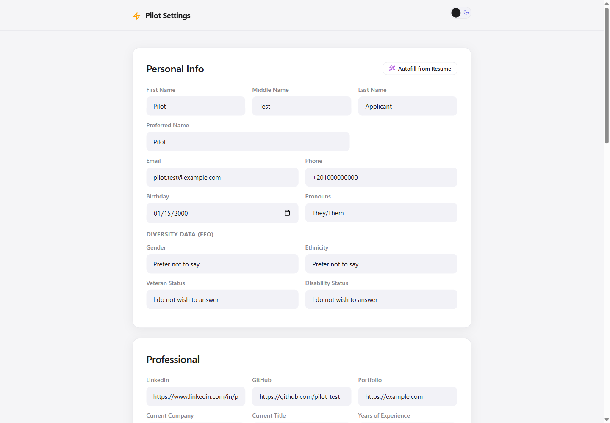
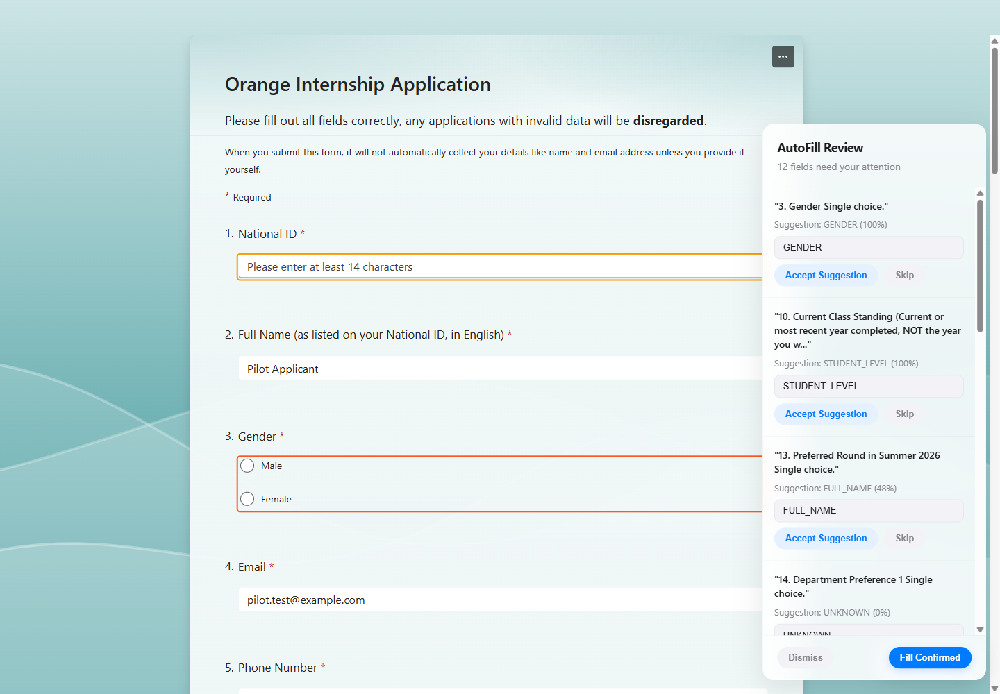
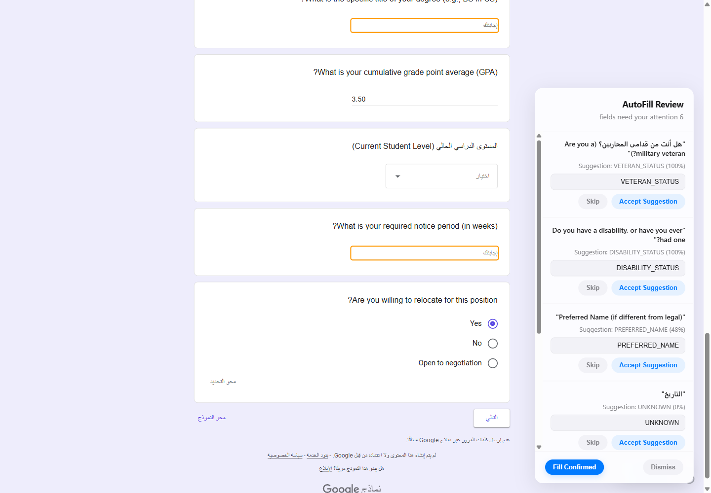

# Pilot Autofill

Pilot is a local-first Chrome extension for reviewing and filling job-application
forms. It combines accessibility semantics, bilingual field classification, and
framework-aware input handling instead of relying on one site's CSS structure.

> Development prototype. Pilot is not published in the Chrome Web Store, and
> compatibility varies across application platforms.

## Product walkthrough

These screenshots use a synthetic profile on public forms. Pilot filled only
the fields it classified confidently, routed sensitive or ambiguous fields to
the review panel, and did not submit either form.

### Local profile



### Review-first autofill on Microsoft Forms



### Sensitive-field review on Google Forms



## What is implemented

- Accessibility-first extraction using labels, ARIA relationships, fieldsets,
  native controls, and open Shadow DOM roots.
- A semantic fallback parser for forms with incomplete accessibility metadata.
- English and Arabic rule-based classification with confidence bands.
- Separate native and React-aware filling strategies.
- A review overlay for ambiguous, file, essay, and sensitive EEO fields.
- Local profile and PDF storage, including resume-to-profile parsing.
- Optional direct integration with Gemini, OpenAI, or Anthropic using the
  user's own API key.
- Local field-metadata collection with opt-in cloud sharing for a future
  learned classifier.

## Why the architecture changed

Pilot reached its current design through three explicit experiments retained in
the repository history:

1. **Input-First** scanned controls individually. It worked on simple forms but
   fragmented radio and checkbox questions and gathered noisy context.
2. **Question-First** grouped controls by surrounding containers. It improved
   multi-choice handling but depended on brittle, platform-specific DOM and CSS
   structures.
3. **A11y-First** uses accessibility relationships as the primary structure and
   falls back to semantic control scanning. This is the current `main` design.

The `Input-First` and `question-first` branches preserve the earlier approaches
and their retrospectives. They are design evidence, not alternative releases.

## Pipeline

```text
page controls
    -> A11yParser
    -> SemanticParser fallback
    -> RuleBasedClassifier
    -> confidence and safety routing
       -> direct fill
       -> review overlay
       -> file selection
       -> manual/AI-assisted essay review
```

The extension deliberately blocks sensitive EEO values from the silent fill
path. Gender, ethnicity, veteran status, and disability status always require
explicit review. File fields and low-confidence classifications are also never
silently submitted.

## Install locally

1. Clone this repository.
2. Open `chrome://extensions` in Chrome.
3. Enable **Developer mode**.
4. Choose **Load unpacked** and select the repository root.
5. Open Pilot's settings page and create a local profile.

No build step is required. AI features are optional; when enabled, requests are
sent directly to the selected provider with the API key stored in Chrome local
storage.

## Verify the code

Node.js 20 or newer is required only for repository checks:

```bash
npm ci
npm run check
npm test
```

The dependency-free suite verifies classifier behavior, English and Arabic
labels, explicit review routing, disabled-field handling, and the hard EEO
safety boundary. GitHub Actions runs the same checks on every push and pull
request.

The [live compatibility evidence](TESTING.md) records a synthetic-data,
non-submitting run against real Google Forms, Microsoft Forms, and application
pages. It includes failures and unavailable pages as well as successful fills.

## Privacy and permissions

The profile, uploaded files, and provider API key are stored locally by the
extension. Pilot requests access to all URLs because job applications can be
hosted on arbitrary domains; that broad permission deserves explicit review
before any store release.

Classification metadata is recorded locally. Cloud sharing is disabled by
default and requires an explicit confirmation. Shared records may contain field
labels, surrounding question text, classification outcomes, and the site
hostname, but not the values Pilot fills into the form. The cloud sync service
is an experimental Phase 2 component and is not required for autofill.

## Known limitations

- Browser JavaScript can traverse open Shadow DOM roots, not closed roots.
- Synthetic events cannot guarantee compatibility with every framework or
  anti-automation check.
- There is no published accuracy benchmark yet; claims such as “near-perfect”
  are intentionally avoided.
- The live compatibility matrix exercises the core page runtime, but extension
  popup, service-worker, and review-panel interaction still need browser-level
  automation.
- Cloud dataset infrastructure still needs a separate security and deployment
  review before it should be presented as production-ready.

## Repository map

```text
background/       service worker, provider calls, optional dataset sync
content/          parsers, classification, fill strategies, and review overlay
popup/            page controls and metadata-sharing preference
settings/         profile, files, and optional AI configuration
storage/          Chrome storage, IndexedDB, and resume parsing
tests/            dependency-free regression tests
scripts/          repository and Manifest V3 validation
```
